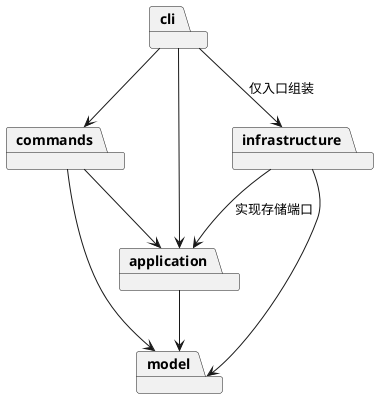

# Lab1 Phase 1：SVG 编辑器

## 架构方案

### 模块划分

| 模块 | 职责 |
| --- | --- |
| `src/model` | 有行为的图形类、组合树、画布、数值与结构约束 |
| `src/application` | 编辑器会话、Command 历史、事务边界、文件存储端口 |
| `src/commands` | 一条命令一个类；验证参数并调用模型行为 |
| `src/infrastructure` | SVG XML 编解码、文件系统实现 |
| `src/cli` | 分词、命令分发、REPL 与组装 |
| `tests` | 黑盒命令测试、模型与文件往返测试、依赖规则自查 |

### 设计模式的选择

- **Command（必选）**：具体命令类封装执行行为；编辑命令共用事务与快照撤销基类；History 管理 undo/redo。
- **Composite**：Shape 为统一接口，Group 递归操作子节点，叶子通过各自几何描述实现多态。禁止在业务逻辑里根据 tag 反复分派。
- **Memento**：模型的深拷贝快照记录命令前后状态；先在副本执行，成功才替换当前文档，保证错误不改变状态。
- **Factory**：唯一的图形类型名到构造器映射位于 ShapeFactory；CLI 的命令名映射位于 CommandRegistry。两处暂为显式内置注册，插件化阶段待重构为外部注册入口。
- **依赖倒置**：应用定义 DocumentStore 端口，由文件系统适配器实现。

### 依赖方向规则

model 不依赖其他业务模块或 Node I/O；application 只依赖 model；commands 依赖 application/model；infrastructure 依赖 application/model 与 Node 文件系统/XML 库；cli 可依赖上述模块但 I/O 组装仅在 Main。业务代码不反向依赖 cli。测试可依赖所有模块。违反规则的依赖必须修正或记为待处理项。

### 变化点假设

1. 新图形：抽象 Shape 与工厂是扩展点；本阶段只实现六种图形，不预实现 box。
2. 新入口（GUI/agent）：命令对象与 Editor 不依赖 stdin/stdout，可复用。
3. 新存储：DocumentStore 端口隔离文件系统。
4. 大文档的撤销性能：先用 O(n) 快照换取可靠原子性，未来可改增量记录；本阶段不引入复杂增量协议。
5. SVG 的更广泛语法：本阶段保证六类图形和要求的属性；不支持的影响图形的结构应显式拒绝，避免静默损坏。

## 过程记录

- 第一步：读取作业原文，确认 TypeScript、面向对象、一类一文件、Command 与 Composite、Git 分步提交及 final 标签要求。
- 架构决策：采用模型快照事务，避免 group/addto 等修改到一半失败污染树；文件操作成功后才建立历史屏障。
- 待实现后补充真实测试发现与修订，不虚构用户讨论或测试结果。

## 一致性自查

实现完成后补充目录与依赖检查结果。

## 质量保证手段

计划按命令表、错误约定、原子性、撤销粒度、SVG 往返和示例流程逐项自动验证；记录实际运行结果。
