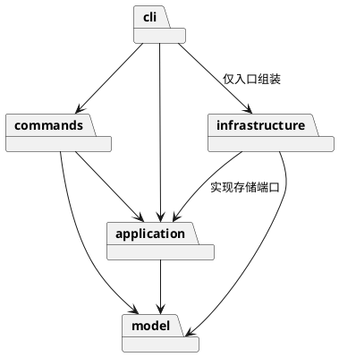

# Lab1 Phase 1：SVG 编辑器

> 进度：第 1 段（2026-10-28）。本文同时区分最终架构设计与当前实现；尚未完成 Command、完整 CLI、SVG I/O 与最终验收。用户指定截止日期：2026-10-31，具体时刻未提供。

## 架构方案

### 模块划分

| 模块 | 职责 |
| --- | --- |
| `src/model` | 有行为的图形类、组合树、画布、数值与结构约束 |
| `src/application` | 编辑器会话、Command 历史、事务边界、文件存储端口 |
| `src/commands` | 一条命令一个类；验证参数并调用模型行为 |
| `src/infrastructure` | SVG XML 编解码、文件系统实现 |
| `src/cli` | 分词、命令分发、REPL 与组装 |
| `tests` | 黑盒命令测试、模型与文件往返测试、依赖规则自查 |

### 设计模式的选择

- **Command（必选，计划第 2 段落地）**：具体命令类封装执行行为；编辑命令共用事务与快照撤销基类；History 管理 undo/redo。
- **Composite（基础已落地）**：Shape 为统一抽象类，Group 递归操作子节点，Rect 实现几何行为，调用方不根据 tag 分派。Group 的 set 保存 SVG 容器样式供子节点继承，不覆盖子节点已有样式。
- **Memento（快照能力已实现，历史待实现）**：Rect/Group 的 clone 深拷贝几何、样式与组合结构；后续命令将记录前后快照，先在副本执行，成功才替换当前文档。
- **Factory（待实现）**：唯一的图形类型名到构造器映射将位于 ShapeFactory；命令名映射将位于 CommandRegistry。两处计划采用显式内置注册，并标注为插件化阶段待重构项。
- **依赖倒置（待实现）**：应用将定义 DocumentStore 端口，由文件系统适配器实现。

### 依赖方向规则

model 不依赖其他业务模块或 Node I/O；application 只依赖 model；commands 依赖 application/model；infrastructure 依赖 application/model 与 Node 文件系统/XML 库；cli 可依赖上述模块但 I/O 组装仅在 Main。业务代码不反向依赖 cli。测试可依赖所有模块。违反规则的依赖必须修正或记为待处理项。

### 变化点假设

1. 新图形：抽象 Shape 与工厂是扩展点；本阶段只实现六种图形，不预实现 box。
2. 新入口（GUI/agent）：命令对象与 Editor 不依赖 stdin/stdout，可复用。
3. 新存储：DocumentStore 端口隔离文件系统。
4. 大文档的撤销性能：先用 O(n) 快照换取可靠原子性，未来可改增量记录；本阶段不引入复杂增量协议。
5. SVG 的更广泛语法：本阶段保证六类图形和要求的属性；不支持的影响图形的结构应显式拒绝，避免静默损坏。

## 过程记录

- 第一步：读取作业原文，确认 TypeScript、面向对象、一类一文件、Command 与 Composite、Git 分步提交及 final 标签要求。
- 架构决策：采用模型快照事务，避免 group/addto 等修改到一半失败污染树；文件操作成功后才建立历史屏障。
- 用户反馈：要求按真实开发阶段推进，本次只完成一小段；提供远程仓库 `https://github.com/wxz667/SVG` 和 10 月 31 日截止日期。
- **AI 自查意见 1：阶段边界。** 文档的 box 为后续插件化目标，不应把它提前加入本阶段必做清单；另外根级 g 禁止 ungroup，save 成功也要阻断历史。已记录为后续验收重点。
- **AI 自查意见 2：模型封装。** 如果公开可修改的 children 数组或属性对象，外部代码能绕过约束破坏模型。实现改为私有字段、只读且冻结的集合副本，通过 add/remove/set 修改；已有测试验证外部直接写入会被阻止。
- **AI 自查意见 3：原子性。** 只验证输入是有限数不够，浮点乘法/加法仍可能溢出。Rect 在所有结果通过校验后才写入；Group 先在副本预检全部孩子，再执行变更。实际测试覆盖“后一个子节点溢出，前一个子节点不得改变”。这是本阶段的小规模实现；后续应用层事务完成后应复查预检复制成本，避免重复全树复制。
- **AI 自查意见 4：Windows 测试入口。** 首次构建后，`node --test tests/*.test.mjs` 因 Windows 不展开通配符而失败，已改成 `node --test` 自动发现，重新运行 11 项测试全部通过。
- 环境问题：旧 npm 源不可访问，改用项目级官方 registry；默认 npm 缓存不在允许写入范围，安装时将缓存放入工作区。Node 的入口真实路径解析触发沙箱 EPERM，验证进程临时设置 preserve-symlinks 选项，没有将本机专属路径写入工程配置。

以上“AI 自查意见”为本次 AI 实施中的真实审查记录，不冒充用户亲自提出的意见。后续继续补充实际缺陷、验证与修订，不预写虚构过程。

### 第一阶段评审：用户确认的意见（2026-10-28）

第一阶段实现和基础测试完成后，AI 整理了以下三条意见，用户确认“可以就按你这个来”。本节记录本次评审认可的原则及后续要求。

1. **优先满足本阶段要求。** 先完成规定的六类图形和命令，暂不实现后续阶段的 `box`，避免扩展功能挤占基础功能的开发时间。
2. **保证封装和失败原子性。** 图形属性、容器子节点不能被外部随意修改；重复 ID、循环嵌套、非法数值等操作失败后，原有状态必须保持不变。
3. **分段实现并验证。** 每阶段完成后先编译、测试，再单独提交；文档明确区分已实现和待实现内容，最终验收完成后再打 `final` 标签。

落实情况：第 1 条作为后续实现范围；第 2 条认可当前模型基础，并要求后续命令层、文件读写与历史管理继续满足失败原子性；第 3 条延续分段提交与测试流程。本次确认发生在基础实现之后，不倒写为开发前提出的要求。

## 一致性自查

1. **模块划分**：当前实际源文件只有 `src/model/{Shape,Rect,Group,Numbers}.ts`；四个类各占一个同名文件，与第一段范围一致。其他规划目录尚未建立，属于未完成项；不得声称最终架构已经全部实现。
2. **依赖方向**：检查当前四个源文件的 import，仅引用同目录模型类；没有 Node I/O、CLI 或基础设施依赖，没有按 tag 的 switch 分派。模型测试位于 tests，以公开行为验证模型。当前无发现的依赖违规；全工程一致性检查待最终阶段执行。

## 质量保证手段

本阶段实际执行 `npm test`（含 `tsc -p tsconfig.json`）：**11 项通过，0 项失败**。测试覆盖：浮点与默认样式省略；增量移动和位置/尺寸一起缩放；属性白名单；非法数值；嵌套 Composite；深拷贝隔离；大小写敏感 ID；重新归属；循环与 ID 冲突失败原子性；只读集合；后续子节点溢出时不部分执行。

这些结果只证明当前模型基础，不代表完整功能验收。最终仍须按命令表、错误约定、undo/redo 屏障、SVG 缺 ID 补全、文件读写失败原子性和两个示例流程逐项验证。

### 尚未完成的验收项

- circle、ellipse、line、text、画布根与图形工厂。
- 全部 CLI 命令、Command 与历史管理、提示符、双引号分词、注释。
- SVG 序列化/读取、自动 ID 与警告、文件路径语义。
- 完整需求测试矩阵、示例 SVG、最终一致性自查。
- 完整作业完成后的 `final` 标签与远程校验；当前仅阶段提交。
