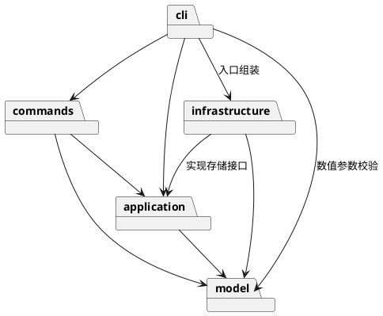

# SVG 编辑器设计与开发记录

## 架构方案

### 模块划分

| 模块 | 职责 |
| --- | --- |
| `src/model` | 图形对象、组合树、画布及几何与结构约束 |
| `src/application` | 编辑会话、命令历史、事务边界与存储接口 |
| `src/commands` | 封装各条命令，验证参数并调用模型行为 |
| `src/infrastructure` | SVG 编解码和文件系统读写 |
| `src/cli` | 命令分词、分发、交互循环及入口组装 |
| `tests` | 模型、命令、文件往返及依赖规则测试 |

### 设计模式的选择

- **Command**：`EditCommand` 定义执行、撤销和重做，`src/commands` 中十个具体命令类实现各自操作；`History` 管理两条历史栈，`Editor` 编排会话。每条编辑命令是一个撤销单元，失败命令不进入历史。新建画布、读取、保存和修改尺寸成功后设置历史屏障。
- **Composite**：`Shape` 是统一抽象，五种叶子通过 `GeometricShape` 复用几何行为，`Group` 递归处理子节点，调用方无需按图形类型分派。移动和缩放先递归生成已校验的变更，再统一写入，避免重复复制子树。`Canvas` 管理整棵树的查找、归属与顺序。
- **Memento**：`Canvas.clone()` 深拷贝画布、图形、文字内容和分组。`EditCommand` 在副本上执行，成功后保存前后快照并替换当前文档；撤销重做从快照恢复。对外查询也返回副本，避免查询者绕过历史修改当前状态。
- **Factory**：`ShapeFactory` 集中实现六种类型名到图形类的映射，创建和 SVG 读入共用该映射；CLI 的命令名映射集中于 `CommandRegistry`。这两处是允许的按名字分派位置，插件化时需重构为外部注册入口。
- **依赖倒置**：应用层定义抽象存储接口 `DocumentStore`，基础设施层的 `FileDocumentStore` 实现读写，`Main` 完成注入。模型和命令不直接访问文件系统。

### 依赖方向规则

| 模块 | 允许依赖 | 理由 |
| --- | --- | --- |
| model | 同模块模型类 | 保持几何和树结构逻辑独立于交互及 I/O |
| application | model | 编排模型操作，不绑定具体存储实现 |
| commands | application、model | 封装用例，复用模型约束 |
| infrastructure | application、model、文件系统/XML 库 | 实现应用定义的接口并转换模型 |
| cli | commands、application、model；入口可引用 infrastructure | 处理输入输出，复用数值校验并组装具体实现 |
| tests | 所有被测模块 | 验证行为和模块边界 |

业务模块不得反向依赖 cli。违反上述规则的依赖应列为待处理项。

### 变化点假设

1. **增加图形类型**：保留 `Shape` 抽象及工厂扩展点；先实现要求中的六种图形，不提前加入后续插件类型 `box`。
2. **增加交互入口**：将命令和模型与终端输入输出分离，便于以后接入图形界面。
3. **替换存储方式**：通过存储接口隔离文件系统，后续可替换具体适配器。
4. **大文档撤销性能**：先采用全量快照保证正确性；如文档规模增大，再考虑增量历史，暂不引入复杂的变更协议。
5. **扩大 SVG 支持范围**：编解码集中在基础设施层；对不支持且影响图形语义的内容明确报错，避免静默丢失。

## 过程记录

### 工程与模型基础

- 建立 TypeScript 工程，开启严格编译检查，采用一类一文件的组织方式。
- 实现 `Shape`、`Rect`、`Group` 与 `Numbers`，将几何操作和约束放入模型，避免把图形做成公共数据袋。
- 为避免外部绕过约束修改结构，属性和子节点集合返回冻结副本，通过 `set`、`add`、`remove` 修改内部状态。
- 检查浮点运算时发现，仅校验输入有限还不足以防止结果溢出。最初采用矩形计算后写入、分组副本预检的方案，测试覆盖后一个节点失败时前面节点不变。随后在边界复查中测量并修正了重复预检的复制成本，见下节。
- Windows 下 `node --test tests/*.test.mjs` 未能展开通配符，改用 `node --test` 自动发现测试，重新验证通过。
- 评审确定三项原则：优先实现规定功能；保持封装及失败原子性；每次实现后验证并分步提交，最终验收后再打 `final` 标签。

### 图形扩展、命令与撤销重做

- 补充圆、椭圆、线和文字。将矩形原有的几何校验、移动与缩放抽入 `GeometricShape`，各子类只定义坐标、尺寸及自身行为，避免多份重复校验逻辑。
- 数值解析改为十进制及科学计数法校验，拒绝空字符串、十六进制和非有限值，防止 JavaScript 的隐式转换把不合法输入当作坐标。
- 引入 `Canvas`，统一管理全局 ID、父子关系和层级顺序。内部根容器不占用可寻址 ID，测试验证同名普通图形仍可创建。
- 分组按原文档顺序收编，不依赖参数排列。同父级分组占据首个选中节点的位置；跨父级分组追加到画布根；解组将子节点插回原容器的位置。根级容器按要求禁止解组。
- 实现十个编辑命令及 `Editor`、`History`。先执行副本，成功后再更新文档和历史；测试验证失败编辑不会清除重做记录，成功的新编辑会清除重做记录。
- 验证删除子树、分组和解组的撤销粒度：一次撤销恢复全部图形、归属及顺序。画布操作成功后建立历史屏障，下一条成功编辑开启新历史。
- 添加模块依赖与一类一文件检查，与行为测试一起运行。

### 命令行与 SVG 读写

- 接入 `npm run cli`，提供 `svg>` 提示符，支持逐行输入、双引号参数、空文本、整行注释和 UTF-8 脚本回放。分词保留引号标记，区分文本中的 `"in"` 和创建命令的归属子句。
- `tree` 和 `show` 通过图形多态方法显示几何、样式及文字，不另外建立图形类型分派表。显示命令不进入历史。
- 采用 saxes 严格解析 XML，先构造临时文档，全部成功后才更新当前文档及读入路径。错误统一输出为一行 `error:`，交互继续接受下一条命令。
- 自动 ID 分配先扫描全文件显式 ID，再按标签加序号补全，避免与后出现的 ID 冲突。解析失败时不输出未生效的补名警告。
- 保存先完成 XML 转义和内容校验，再写入同目录临时文件并替换目标；写入失败保留文档及历史。无参数 `save` 按要求使用最近一次成功 `read` 的路径，显式另存不会改变该路径；`init` 清除读入路径。
- 将 CLI 对 model 的依赖明确加入方案：参数解析复用 `Numbers`，避免维护两套数值规则；架构测试同步检查该规则。
- 加入两节点流程图命令脚本和外部 SVG 示例。实际启动进程回放脚本后，保存并读回 8 个元素，验证中文文本、层级和撤销后的坐标。

### 兼容性与边界复查

- 对照背景示例发现，嵌套的 `translate`、`scale` 以及文字的 `font-size`、`text-anchor` 尚不能读入。新增不可变的 `Transform` 值对象，按 SVG 顺序组合平移与正数等比缩放，并在保存和快照中保留变换，避免将变换直接展开后丢失文字外观。
- 导入属性与 CLI 的 `set` 分开处理：外部文件允许上述显示属性及 px 长度，但 `set` 仍严格使用作业规定的白名单。新增 `examples/transforms.svg`，保留背景示例中的缺失 ID，用测试确认补名、文字样式和变换后位置。
- 明确变换下的编辑语义：`move` 的增量以目标父级坐标系为准，递归时换算到子节点局部坐标；`scale` 同时缩放几何值及变换平移量，保留原变换的缩放因子。树和属性显示包含 transform，显示的几何值为局部坐标。
- 解组前将被移除容器的变换及继承样式传给子节点，保留子节点显式设置的样式，使解组前后位置和外观一致；撤销仍恢复原始树。
- 用 12 层分组复现一次移动导致 4095 次叶子复制的问题。改为先生成全部变更、验证通过后统一写入；100 层回归用例确认移动和缩放均不复制叶子，且保持原对象引用。深拷贝也直接复制已校验结构，不再逐层重新扫描全树 ID。
- 修正 `ungroup` 找不到目标时的错误信息，统一为 `no such shape`；补充完整典型会话回放，核对分组错误、撤销重做、保存后的历史屏障和外部文件读入。

当前 SVG 读写范围：六类图形、规定的几何属性及 fill/stroke/stroke-width；文字作为元素内容。支持 XML 声明、注释、CDATA 和命名空间，支持无单位及 px 长度、嵌套平移和正数等比缩放，保留 font-size/text-anchor。viewBox 需与画布尺寸一致。旋转、斜切、非等比缩放、路径、其他扩展属性及百分比尺寸明确报错，不静默删除。读入嵌套深度上限为 128。

## 一致性自查

在实现完成后，对照实际目录和代码依赖统一检查并记录结果。

## 质量保证手段

当前严格编译和自动化测试结果为 **68 项通过，0 项失败**，覆盖模型、命令、CLI、SVG 读写、回归用例与架构检查。通过 `npm test` 可统一运行；本轮使用 `npm run build` 与 `node --test --test-reporter=spec` 分别检查构建及测试结果。

测试覆盖浮点坐标、默认样式省略、增量移动、位置与尺寸同步缩放、属性白名单、非法数值、嵌套分组、深拷贝隔离、大小写敏感 ID、重新归属、循环检测、只读集合及溢出时的失败原子性。

命令测试覆盖创建时指定容器、删除子树、分组顺序、解组位置、前后层级调整、撤销重做分支、画布历史屏障，以及失败操作对文档和历史的保护。架构检查覆盖五个源码模块的依赖方向和类名与文件名对应关系，文件 I/O 的组装限定在 Main。

CLI 和读写测试覆盖全部命令分发、带空格参数、错误后继续执行、缺失 ID 补全、重复 ID、特殊字符往返、畸形 XML、文件失败原子性、保存/读取后的历史屏障，并通过子进程验证脚本入口。另执行 `npm run cli -- examples/flowchart.commands`，确认启动命令可用。

本轮新增回归测试核对变换组合顺序、背景示例的已知画布坐标、解组后样式与位置、100 层分组复制次数、变换溢出的原子性，以及完整典型会话。测试不仅检查编解码结果相同，也用示例的已知坐标独立核对变换结果。
