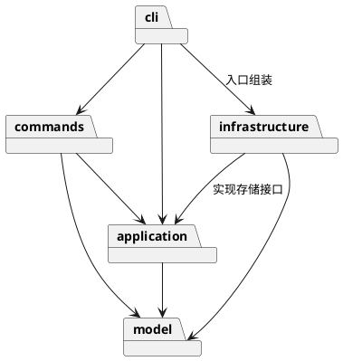

# SVG 编辑器设计与开发记录

## 架构方案

### 模块划分

| 模块 | 职责 |
| --- | --- |
| `src/model` | 图形对象、组合树、画布及几何与结构约束 |
| `src/application` | 编辑会话、命令历史、事务边界与存储接口 |
| `src/commands` | 封装各条命令，验证参数并调用模型行为 |
| `src/infrastructure` | SVG 编解码和文件系统读写 |
| `src/cli` | 命令分词、分发、交互循环及入口组装 |
| `tests` | 模型、命令、文件往返及依赖规则测试 |

### 设计模式的选择

- **Command**：计划将每条命令封装为独立对象，由历史管理器处理撤销与重做。编辑命令记录执行前后的状态，显示命令不进入历史，文档操作成功后设置历史屏障。
- **Composite**：已通过 `Shape`、`Rect`、`Group` 落地。叶子和容器提供统一的移动、缩放和属性操作接口；`Group` 递归处理子节点，调用方无需按图形类型分派。
- **Memento**：`Rect.clone()` 与 `Group.clone()` 已提供独立的深拷贝。后续将用于命令快照，先在副本上执行，成功后再替换文档，保证失败不影响原状态。
- **Factory**：计划由 `ShapeFactory` 集中完成类型名到图形类的映射。命令名映射集中于 `CommandRegistry`。这两处是允许的按名字分派位置，插件化时需重构为外部注册入口。
- **依赖倒置**：计划由应用层定义存储接口，由基础设施层实现，避免命令直接访问文件系统。

### 依赖方向规则

| 模块 | 允许依赖 | 理由 |
| --- | --- | --- |
| model | 同模块模型类 | 保持几何和树结构逻辑独立于交互及 I/O |
| application | model | 编排模型操作，不绑定具体存储实现 |
| commands | application、model | 封装用例，复用模型约束 |
| infrastructure | application、model、文件系统/XML 库 | 实现应用定义的接口并转换模型 |
| cli | commands、application；入口可引用 infrastructure | 处理输入输出并组装具体实现 |
| tests | 所有被测模块 | 验证行为和模块边界 |

业务模块不得反向依赖 cli。违反上述规则的依赖应列为待处理项。

### 变化点假设

1. **增加图形类型**：保留 `Shape` 抽象及工厂扩展点；先实现要求中的六种图形，不提前加入后续插件类型 `box`。
2. **增加交互入口**：将命令和模型与终端输入输出分离，便于以后接入图形界面。
3. **替换存储方式**：通过存储接口隔离文件系统，后续可替换具体适配器。
4. **大文档撤销性能**：先采用全量快照保证正确性；如文档规模增大，再考虑增量历史，暂不引入复杂的变更协议。
5. **扩大 SVG 支持范围**：编解码集中在基础设施层；对不支持且影响图形语义的内容明确报错，避免静默丢失。

## 过程记录

### 工程与模型基础

- 建立 TypeScript 工程，开启严格编译检查，采用一类一文件的组织方式。
- 实现 `Shape`、`Rect`、`Group` 与 `Numbers`，将几何操作和约束放入模型，避免把图形做成公共数据袋。
- 为避免外部绕过约束修改结构，属性和子节点集合返回冻结副本，通过 `set`、`add`、`remove` 修改内部状态。
- 检查浮点运算时发现，仅校验输入有限还不足以防止结果溢出。矩形在全部计算通过后才写入；分组先在副本预检所有孩子，防止后一个节点失败时前面的节点已经改变。测试覆盖了该情况。后续引入应用层事务时需复查重复预检的复制成本。
- Windows 下 `node --test tests/*.test.mjs` 未能展开通配符，改用 `node --test` 自动发现测试，重新验证通过。
- 评审确定三项原则：优先实现规定功能；保持封装及失败原子性；每次实现后验证并分步提交，最终验收后再打 `final` 标签。

## 一致性自查

在实现完成后，对照实际目录和代码依赖统一检查并记录结果。

## 质量保证手段

当前执行 `npm test`，包含 TypeScript 严格编译和模型测试，结果为 **11 项通过，0 项失败**。

测试覆盖浮点坐标、默认样式省略、增量移动、位置与尺寸同步缩放、属性白名单、非法数值、嵌套分组、深拷贝隔离、大小写敏感 ID、重新归属、循环检测、只读集合及溢出时的失败原子性。

后续随命令和文件功能加入对应测试，最终依据命令表、错误约定、撤销重做语义、SVG 往返和示例会话确认功能覆盖。
